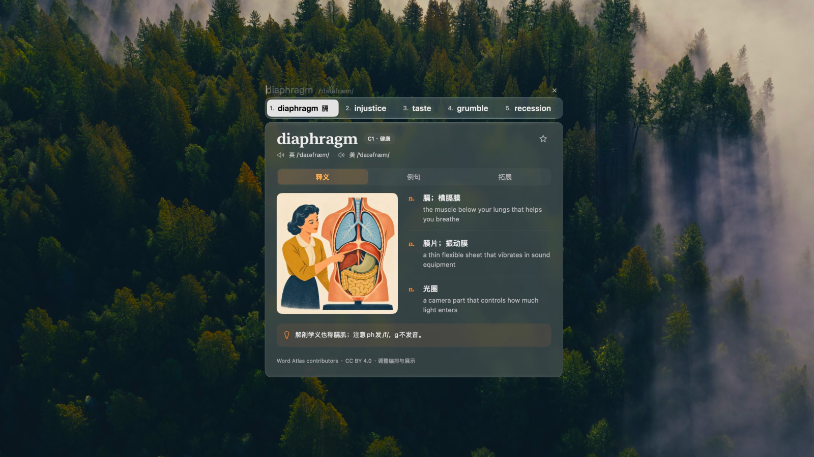

  

# MOYU

**墨鱼时间，顺便把英语学了。**

MOYU 是一款 Mac 上的英语学习工具。通过快捷键唤出输入条，利用碎片时间练习单词与句子。

## 下载

当前版本：[v0.1.0 预览版](https://github.com/CatMuse/MOYU/releases/tag/v0.1.0)。

- 系统要求：macOS 26 或更新版本。
- 芯片：Apple Silicon（M 系列），本版本不支持 Intel Mac。
- [下载 DMG 安装包](https://github.com/CatMuse/MOYU/releases/download/v0.1.0/MOYU-0.1.0-arm64.dmg)，将 MOYU 拖入应用程序文件夹；也可下载 Release 中的 ZIP。
- 手动打开应用会显示控制中心，关闭窗口后继续驻留菜单栏。默认快捷键为 Shift+Command+M。
- 本预览版未经过 Developer ID 签名和 Apple 公证。首次打开若被系统拦截，请确认下载来源后，在“系统设置 → 隐私与安全性”中按系统提示打开。

## 使用与试用

- 首次主动唤出练习输入条时，自动开始七天试用。
- 支持单词与句子练习，学习记录保存在本机。
- 正式版本的购买入口位于 MOYU 客户端中，先下载体验，再决定是否购买。
- 永久授权包含当前及未来所有软件版本，可同时激活两台 Mac。
- 首次激活需要联网；激活后可永久离线使用。

## 更新记录

参见 [CHANGELOG.md](CHANGELOG.md) 和各版本的 Release 说明。

## 问题反馈

可以通过 [Issues](https://github.com/CatMuse/MOYU/issues) 反馈安装和使用问题。请提供应用版本、macOS 版本及复现步骤；不要在公开问题中填写激活码、购买邮箱或支付凭据。

本仓库用于发布安装包、版本说明及收集反馈，不包含 MOYU 应用源码或授权服务源码。
